# vdb — a vector database in C++20

vdb stores embeddings durably, searches them with HNSW and product quantization,
filters by metadata with a selectivity-based planner, and serves queries over HTTP or
directly from Python. It is benchmarked against hnswlib and FAISS on the standard
ANN-Benchmarks datasets.

| | |
|---|---|
| **Speed** | recall@10 **0.974 at 3,391 QPS** on SIFT1M, one thread: hnswlib reaches the same recall at 2,601 QPS (vdb is 30% faster), FAISS HNSW 0.978 at 2,285 |
| **Memory** | **292 bytes/vector** with SQ8 codes (vs 676 for float HNSW) at the same recall and 1.8× the QPS; **89 bytes** with IVF-PQ at recall 0.955 |
| **Durability** | **1,000 kill -9 crashes, zero acknowledged writes lost**; fault-injected power loss at every I/O step of flush, compaction and bulk load |

The full API reference is [docs/API.md](docs/API.md); the design write-up, with answers to the usual
interview questions from these measurements, is [docs/WRITEUP.md](docs/WRITEUP.md).

### Demo

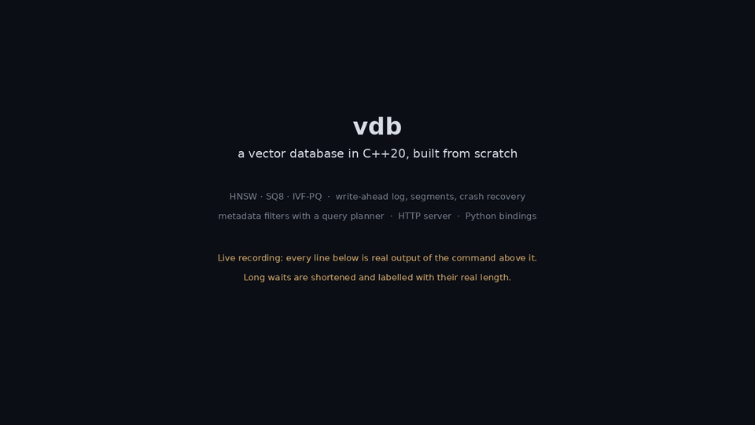

A live recording ([MP4, 1280×720](docs/demo/vdb-demo.mp4)). It runs the C++ test suite, starts the
server, ingests 40,000 Wikipedia passages with metadata, and searches them, including a filtered
search with the planner's explain output. Then it answers a question with citations (RAG), puts 8
clients of load on it, `kill -9`s it after 500 acknowledged writes, and shows all 500 survive the
restart. The panel on the right is the server's own `/metrics`, sampled during the run. Every line is
real output; long waits (loading the embedding model, the ingest) are shortened and labelled with their
real length. Recreate it with `bash demo/run_demo.sh` (`demo/record.py` runs and records the scenes,
`demo/render.py` draws the video).

## Contents

- [Architecture](#architecture)
- [Quick start](#quick-start)
- [Design decisions](#design-decisions)
- [Results](#results)
- [Correctness and durability](#correctness-and-durability)
- [Limitations](#limitations)
- [Repository layout](#repository-layout)
- [References](#references)

## Architecture

Writes and reads take separate paths that meet only at the segments, which is what lets
queries keep running during flush and compaction.

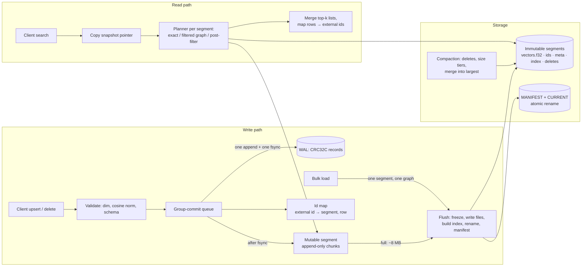

- **Write**: a write is acknowledged only after its log record is synced (sync mode
  `always`). The group-commit leader appends every waiting write in one `write` and
  syncs once, then applies them to the mutable segment and the id map.
- **Flush** (the order matters): freeze the mutable segment and start a new log →
  write `seg-N.tmp/` (vectors, ids, metadata) → build and write the index → fsync every
  file and the directory → rename to `seg-N/` → fsync `segments/` → write
  `MANIFEST-M`, then `CURRENT` through an atomic rename + directory fsync → swap the
  in-memory snapshot → delete logs at or below `flushed_lsn`.
- **Read**: copy the current `shared_ptr<const Snapshot>` (nanoseconds under a tiny
  lock), search every segment in it, merge the per-segment top-k lists. The shared
  pointers keep every segment alive until the reader finishes, even if a flush or
  compaction replaces it meanwhile.

On disk:

```
<data_dir>/collections/<name>/
  CURRENT                 # names the live manifest
  MANIFEST-000110         # config, segment list, flushed_lsn (JSON + CRC32C)
  wal/000114.log          # current log; older ones deleted after a flush
  segments/seg-000109/
    vectors.f32           # 4 KiB header + padded rows, page aligned, mmap'ed
    ids.u64  meta.bin     # external ids; encoded metadata (checksummed blobs)
    index.hnsw            # this segment's index (or .hnsw_sq8, .pq, .ivf_pq, .flat)
    deletes-000111.roar   # deleted rows as of the last checkpoint (roaring bitmap)
```

## Quick start

Linux (or WSL2 on Windows), GCC 12+ or Clang 15+, CMake 3.24+, Ninja. Dependencies
(GoogleTest, Google Benchmark, cpp-httplib, nlohmann/json, CLI11, spdlog, CRoaring) are
fetched by CMake.

```bash
cmake --preset release
```

```bash
cmake --build --preset release
```

```bash
ctest --preset release
```

Presets: `debug`, `release` (`-O3 -DNDEBUG`), `relwithdebinfo`, `asan`
(`-fsanitize=address,undefined`), `tsan`, `fuzz` (Clang + libFuzzer).

### Server

```bash
build/release/vdb-server --data-dir ./data --port 8090 --threads 8 --log-level info
```

```bash
curl -s localhost:8090/v1/collections -d '{"name":"docs","dim":3,"metric":"cosine","schema":{"year":"int64","tags":"keyword_list"}}'
curl -s localhost:8090/v1/collections/docs/upsert -d '{"points":[{"id":1,"vector":[1,0,0],"metadata":{"year":2021,"tags":["ml"]}}]}'
curl -s localhost:8090/v1/collections/docs/search -d '{"vector":[1,0.1,0],"k":5,"filter":{"field":"year","gte":2020},"include":["metadata"],"explain":true}'
curl -s localhost:8090/metrics
```

| Method and path | Body | Returns |
|---|---|---|
| `POST /v1/collections` | `name`, `dim`, `metric`, `index` (`type`, `M`, `ef_construction`, `pq_m`, `nlist`), `schema`, `sync` | 201 |
| `GET /v1/collections` | | names, rows, segments, sizes |
| `GET /v1/collections/{name}` | | config, rows, segments, deleted %, memory by component |
| `DELETE /v1/collections/{name}` | | 200 |
| `POST /v1/collections/{name}/upsert` | `points`: `id`, `vector`, `metadata` | count acknowledged, last LSN |
| `POST /v1/collections/{name}/upsert-binary` | `VDBB` header + ids + float32 rows | same |
| `POST /v1/collections/{name}/bulk-load` | same binary body, ids must be new | one new segment, acknowledged after the manifest commit |
| `POST /v1/collections/{name}/delete` | `ids` | count deleted |
| `GET /v1/collections/{name}/points/{id}` | | vector and metadata |
| `POST /v1/collections/{name}/search` | `vector`, `k`, `ef`, `nprobe`, `rerank`, `filter`, `strategy`, `include`, `explain` | `id`, `score`, `distance`, `metadata` |
| `POST /v1/collections/{name}/search-batch` | `queries`: search bodies | list of result lists |
| `POST /v1/collections/{name}/flush`, `/compact?target_segments=1` | | 202 |
| `GET /health`, `GET /metrics` | | OK, Prometheus text |

Errors are `{"error": {"code": "...", "message": "..."}}`: 400 for a wrong dimension or
bad filter, 404 for an unknown collection or id, 409 if it already exists, 413 for a
body over the limit, 503 with `Retry-After` when the search queue is full.

Filters: `{"and": [{"field": "year", "gte": 2020}, {"field": "tags", "in": ["ml", "db"]},
{"not": {"field": "lang", "eq": "fr"}}]}` with `eq`, `ne`, `in`, `lt`, `lte`, `gt`,
`gte`, `exists` and `and`, `or`, `not`. Field types: `int64`, `float64`, `keyword`,
`keyword_list`, `bool`.

### Python

```bash
pip install .
```

```python
import numpy as np, vdb
col = vdb.Collection.create("./data/sift", dim=128, metric="l2",
                            index={"type": "hnsw", "M": 16, "ef_construction": 200})
col.bulk_load(ids=np.arange(len(base), dtype=np.uint64), vectors=base)  # one segment, no copy
col.upsert(ids=new_ids, vectors=new_rows)                                # normal write path
ids, dists = col.search(queries, k=10, ef=64,
                        filter={"field": "year", "gte": 2020})         # batched, GIL released
col.optimize()                                                           # merge to one segment
col.close()
```

NumPy arrays are read in place (`nb::ndarray<const float, ...>`, no copy for C-contiguous
float32) and the GIL is released during upserts, loads and searches. `vdb.Client
("http://localhost:8090")` is a thin HTTP client with the same methods.

### RAG demo

```bash
pip install sentence-transformers datasets
python rag/ingest.py --max-passages 200000          # Simple English Wikipedia, MiniLM embeddings
LLM_URL=http://localhost:8000 python rag/ask.py "Who discovered penicillin?"
python rag/eval.py --questions rag/questions.jsonl  # hit rate@5: exact vs HNSW vs SQ8 vs IVF-PQ
```

`ask.py` embeds the question, retrieves k = 5 passages (optionally filtered by year),
quotes them in the prompt, and streams the answer with numbered citations from any
OpenAI-compatible `/v1/chat/completions` endpoint (your inference server).
`python rag/mock_llm_server.py` stands in for one when testing the plumbing.

The work directory (embeddings, passages, the four collections) defaults to `rag/work/`; set
`RAG_WORK` to move it. Under WSL keep it, and any `--data-dir`, on the Linux file system: on a
OneDrive-synced `/mnt/c` folder, renaming a just-written segment directory failed with "Permission
denied" while OneDrive held it, so the flush failed.

## Design decisions

Each choice, the alternative, and the measurement behind it (numbers from
`bench/results/`, SIFT1M unless noted; hardware below).

**One distance convention: smaller is closer.** L2 returns squared L2, inner product
returns minus the dot product, cosine normalizes at insert and at query time and then
uses minus the dot product. Every heap, merge and planner compares the same way, which
removes a whole class of sign bugs.

**Rows padded to 16 floats; kernels picked at runtime.** Padding (GloVe's 100 dims → 112,
12% more memory) lets the AVX2/AVX-512/NEON kernels run without a tail loop. Only the
kernel files get `-mavx2 -mfma` / `-mavx512f`; the binary runs anywhere and picks the
best kernel with `__builtin_cpu_supports`. Every kernel is tested against the scalar
reference at every dimension 1–1024.

**HNSW like hnswlib, plus a connectivity repair pass.** Neighbor selection uses the
diversity heuristic (keep a candidate only if it is closer to the new node than to every
neighbor already kept); new nodes take M links per layer, back-links re-prune with the
same heuristic at M (upper) or 2M (layer 0). Pruning can strip a node's last incoming
link, as in hnswlib: building SIFT1M leaves ~360 of 1M nodes unreachable from the entry
point. A post-build pass links each of them from its nearest reachable node, so the
"every node reachable" invariant holds and is tested. Levels come from a hash of
(seed, id), so they do not depend on thread scheduling. Node locks are striped (at most
65,536 mutexes instead of one per node: 40 MB saved per million nodes).
*Result:* recall identical to hnswlib at every `ef` on SIFT1M and GloVe-100.

**Quantization: SQ8 is the sweet spot here.** HNSW over SQ8 codes (128 B/vector instead
of 512) with the whole beam re-ranked on float rows reaches the same recall as float HNSW
(0.9748 vs 0.9743 at ef=80) at **1.8× the QPS** (6,153 vs 3,391): distance computations
read 4× less memory. IVF-PQ (nlist 4096, m=16) is the compact option: 22 B/vector of
codes, recall@10 0.955 at nprobe 64 with 100 re-ranked candidates. Without re-ranking,
PQ recall plateaus at 0.56 on SIFT; re-ranking is not optional.

**IVF-PQ precomputed tables (the FAISS trick).** With residual encoding,
`‖q − c − r‖² = ‖q − c‖² + Σⱼ(‖rⱼ‖² + 2⟨cⱼ, rⱼ⟩) − 2Σⱼ⟨qⱼ, rⱼ⟩`. The middle term depends
only on the list and the code, so it is precomputed per list (nlist × m × 256 floats,
64 MB for SIFT1M); the last term is one table per query. A probed list then costs 4,096
additions instead of 4,096 sub-vector distances. *Measured:* 763 → 1,763 QPS at nprobe 64
(2.3×), identical recall; the price is the 64 MB table.

**Blocked k-means assignment.** IVF training scores 1M points against 4,096 centroids
(2 MB, larger than L2). The point-at-a-time loop re-read every centroid row from L3 for
every point and took over 30 minutes; scoring blocks of 8 points against each centroid
while it sits in L1 brought one full build to under 10 minutes, and FAISS's 64 points per
centroid sampling to under 3.

**LSM-style segments instead of in-place index updates.** Writes go to a WAL and an
append-only mutable segment that readers scan without locks (rows are published with a
release store of the row count); full segments are frozen, written as immutable files
with their own index, and recorded in a manifest via an atomic rename. Crash recovery
is "load the manifest, replay the log tail". The cost is that every segment is its own
graph and every query searches all of them. Holding the same 200k SIFT vectors in 1, 2,
5, 10 or 50 segments, QPS at recall@10 ≥ 0.95 falls from ~8,300 to ~1,400 (6×). Three
mechanisms keep a settled collection at one or two segments: bulk load (one segment, one
graph), size-tiered compaction (tiers 4× apart), and merging the small segments into the
largest once they pass 20% of it, or after the collection has been idle — inserting
their rows into a copy of the large graph, so graph work is proportional to the small
segments. The mutable segment is a tax on every query too (brute-force scanned): a
collection's p50 goes from 0.14 ms with it empty to 0.40 ms at 10k rows, 1.18 ms at 20k
and 4.75 ms at 100k, which is why it flushes at 8 MB (~16k rows of 128 floats) or after
5 minutes.

*Why not index the mutable segment with a small HNSW?* Measured on the same rows (SIFT,
M = 16, one thread, `vdb_bench mutable`):

| Rows | flat scan p50 | small HNSW p50 | HNSW insert cost | HNSW recall vs exact |
|---|---|---|---|---|
| 5k | 0.072 ms | 0.037 ms | 100 µs/row | 0.999 |
| 10k | 0.134 ms | 0.044 ms | 136 µs/row | 0.997 |
| 20k | 0.637 ms | 0.086 ms | 246 µs/row | 0.997 |
| 100k | 2.80 ms | 0.131 ms | 298 µs/row | 0.984 |

A graph would save 0.1–0.5 ms per query at the flush size, but it would cost 100–250 µs
of CPU per write, against well under a microsecond for an append, and it would make
mutable-segment results approximate. At 16k rows a writer core could insert only
4–10k rows/s. The flat segment keeps writes at memory speed and fresh rows exactly
searchable, and the size cap bounds the scan. The jump between 10k rows (5 MB) and
20k rows (10 MB) is consistent with the scan outgrowing this CPU's 12 MB L3 cache.
8 MB stays below that.

**Atomic bit arrays for live deletes, roaring bitmaps on disk.** Deletes set a bit with
`fetch_or` in a per-segment atomic array (125 KB per million rows), so searches read
them with no lock. CRoaring bitmaps are not safe for concurrent reads and writes, so they
are used only for the persisted copy (`deletes-<n>.roar`, written at each flush
checkpoint) and for filter results. Search walks *through* deleted nodes but never
returns them. Measured decay (200k SIFT, ef=64): recall does not fall — the search keeps
going until it holds `ef` live rows, so it explores more — but QPS does, from 6,339
with no deletes to 3,813 at 50% deleted. Delete-driven compaction (above 20% deleted)
rebuilds the segment and restores it (8,571 QPS at 50% deleted: the graph is half the
size).

**`shared_ptr` snapshots for readers.** A search copies the snapshot pointer under a
mutex held for nanoseconds; flush and compaction build new segments off to the side and
publish a new snapshot. ThreadSanitizer caught the one place this went wrong: a range-for
over `snapshot()->on_disk` let the temporary `shared_ptr` die before the loop body.

**Group commit with exclusive sections.** Writers queue; the front writer leads: it
assigns LSNs to every waiting write, appends them with one `write`, fsyncs once, applies
them, and wakes everyone. Freeze, compaction commit and bulk-load commit run as
"exclusive writers" in the same queue, which is what makes the compaction catch-up
(re-applying deletes that hit the input segments mid-compaction) race-free.
*Measured on the ext4 disk (fdatasync ≈ 7–17 ms):* with sync mode `always` and 64
concurrent writers, group commit takes single-row upserts from 129 to 4,608 vectors/s
(36×) and batches of 100 from 13,807 to 177,547 vectors/s (13×). `interval` and `none`
reach 0.5–1.6 M vectors/s.

**Filter planner: a cost model fitted from the benchmark.** The first rule (exact below
10,000 matches, otherwise graph search with `ef / selectivity`) over-raised `ef`: at 10%
selectivity it spent 5× the work for +0.001 recall (179 vs 947 QPS). The filtered graph
search already keeps walking until it holds `ef` *matching* rows, so its cost grows like
1/s on its own: measured ≈ 10·ef/s distance computations, versus `matches` for exact
search. The planner now picks exact when `matches ≤ max(10,000, 10·ef/s)` and graph
search with the caller's `ef` otherwise. *Result:* the planner line stays within a few
percent of the best single strategy at every selectivity from 0.1% to 100%.

**HNSW parameters.** M=16, ef_construction=200 by default (hnswlib's usual setting).
M=32 buys recall at small `ef` (0.959 at ef=40 vs 0.927) for 1.8× the graph memory and
1.4× the build time; ef_construction=400 adds ~0.002 recall at 1.6× build time.

## Results

**Hardware:** Intel i7-1165G7 laptop (4 cores / 8 threads, AVX-512), 8 GB RAM given to WSL2
(Linux 6.6), GCC 15.2, release build with `-march=native`. hnswlib 0.8.0 and faiss-cpu 1.15.1 from pip
on the same machine. QPS is single-threaded unless noted, the median of three runs. Reproduce with
`bench/run_all.sh` (datasets from `bench/prepare_data.sh`), then `python bench/plot.py`.

### Recall vs throughput

The fastest configuration of each system that reaches recall@10 ≥ 0.95, at the same build parameters
(M = 16, ef_construction = 200; nlist = 4096, m = 16). On GloVe no HNSW reaches 0.95 at M = 16, so the
row shows the highest recall measured (ef = 640).

| Dataset | System | Parameters | Recall@10 | QPS, 1 thread | p99 ms | Build s | Bytes per vector |
|---|---|---|---|---|---|---|---|
| sift | **vdb hnsw** | M=16, ef=80 | 0.9743 | **3,391** | 0.69 | 210 | 676 |
| sift | hnswlib | M=16, ef=80 | 0.9743 | 2,601 | 1.20 | 210 | 652 |
| sift | faiss_hnsw | M=16, ef=80 | 0.9775 | 2,285 | 1.28 | 232 | 640 |
| sift | **vdb hnsw_sq8** | M=16, ef=80, rerank auto | 0.9748 | **6,153** | 0.29 | 106 | **292** |
| sift | vdb ivf_pq | nprobe=64, rerank=100 | 0.9551 | 1,763 | 1.17 | 142 | 89 |
| sift | faiss_ivfpq | nprobe=64, rerank=100 | 0.9557 | 2,504 | 1.40 | 86 | 26 |
| sift | vdb flat | | 0.9991 | 22 | 80.9 | 0 | 512 |
| sift | faiss_flat | | 0.9994 | 166 | 73.1 | 0.4 | 512 |
| glove-100 | **vdb hnsw** | M=16, ef=640 | 0.9363 | 537 | 3.69 | 368 | 564 |
| glove-100 | hnswlib | M=16, ef=640 | 0.9358 | 539 | 3.53 | 340 | 540 |
| glove-100 | faiss_hnsw | M=16, ef=640 | 0.9318 | 415 | 4.98 | 429 | 528 |
| glove-100 | vdb flat | | 1.0000 | 30 | 66.2 | 0 | 400 |

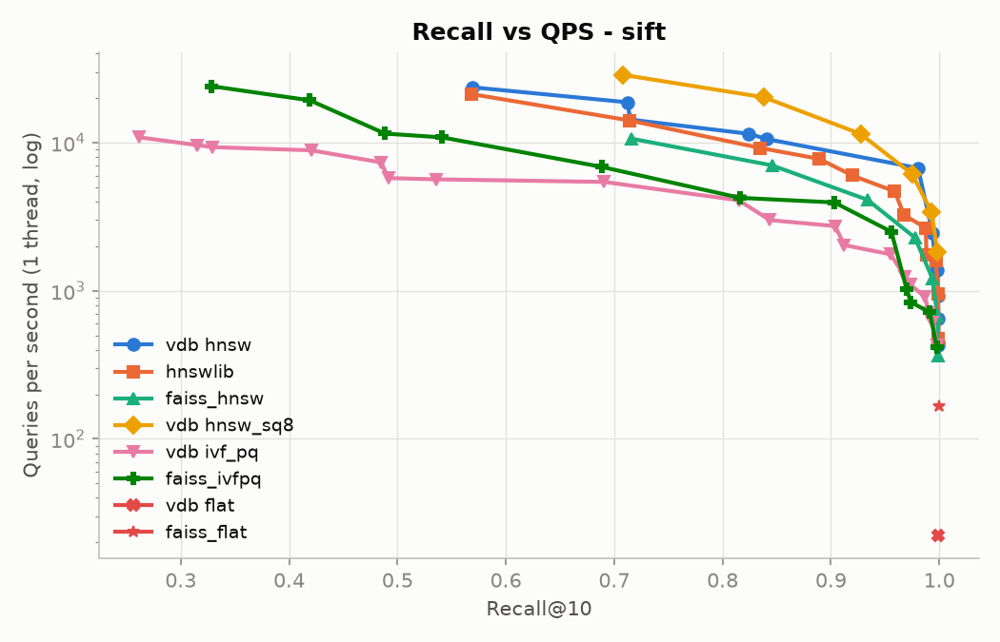
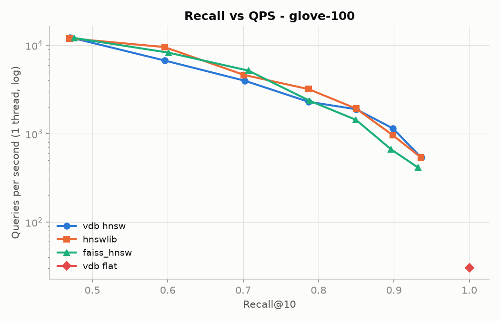

Where vdb loses, and why:

- **FAISS IVF-PQ is 1.4× faster** at the same recall and builds in 60% of the time. `perf` shows vdb's
  IVF-PQ search is compute-bound (IPC 2.3, 72% in the code-scan loop), so that loop, which FAISS
  hand-tunes, is where the gap is. vdb's
  89 bytes/vector include 67 MB of precomputed distance tables (the FAISS trick, which took vdb from 763
  to 1,763 QPS); FAISS's 26 bytes count only codes and ids.
- **FAISS flat is 7.5× faster** because it searches the whole query batch with one BLAS matrix
  multiply, reading each base vector once per block of queries. vdb's exact search goes one query at a
  time, the way the engine uses it (small segments, filtered subsets), so it is bound by memory
  bandwidth: 512 MB per query at ~11 GB/s.
- On GloVe, vdb and hnswlib are tied. 100-d cosine is a harder dataset where both spend their time in
  the same graph walk.

### Memory vs recall

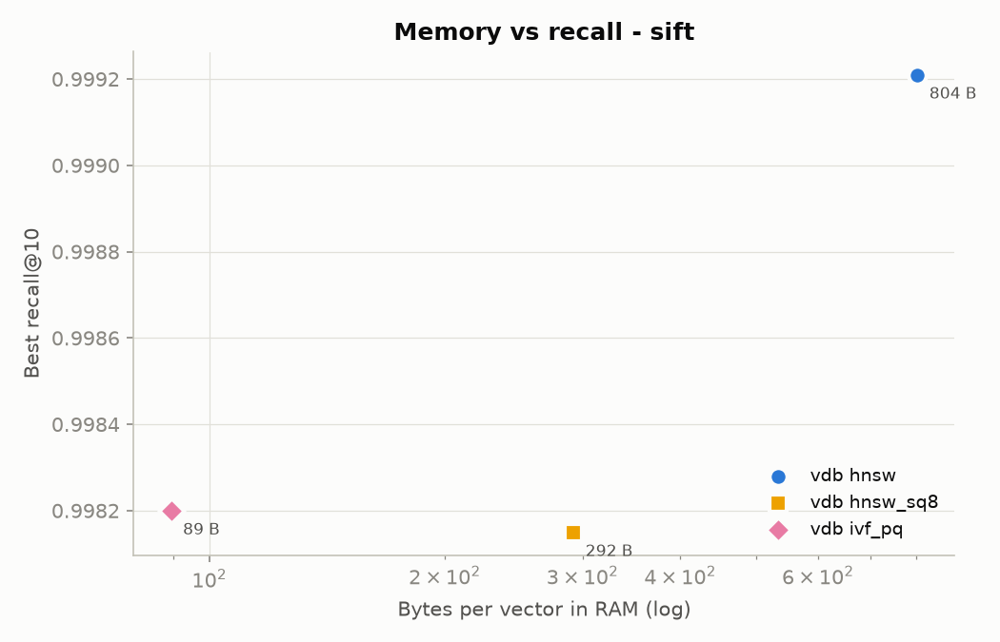
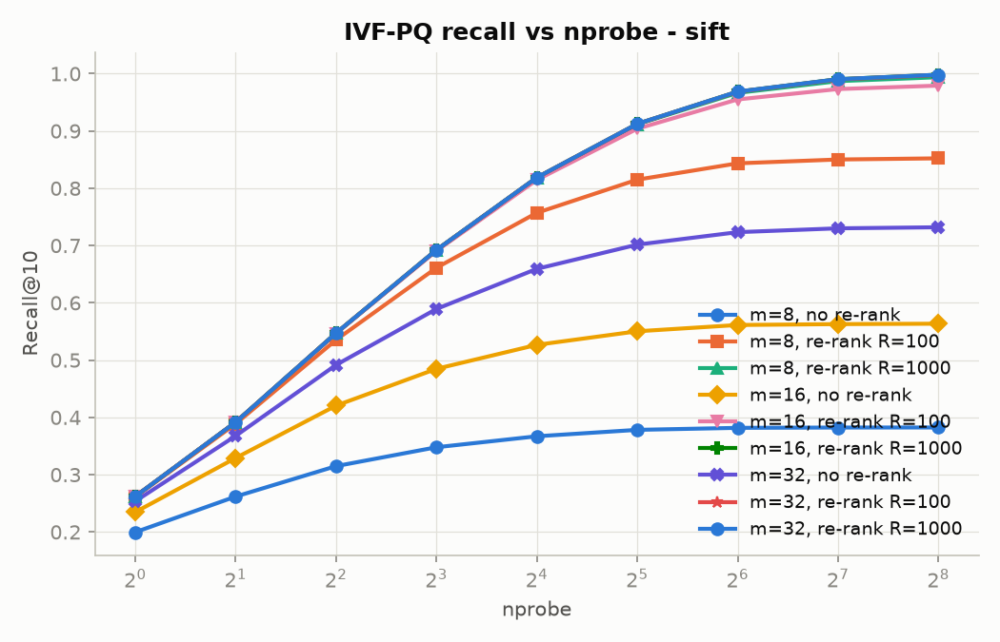

SQ8 codes are a quarter of the memory traffic per distance, so SQ8-HNSW is both smaller and faster than
float HNSW; re-ranking the beam with the float vectors (memory-mapped, read only for the candidates)
recovers the recall. For IVF-PQ, re-ranking 100 candidates lifts recall@10 from 0.56 to 0.96 for 8% of
the QPS.

### HNSW parameters and build

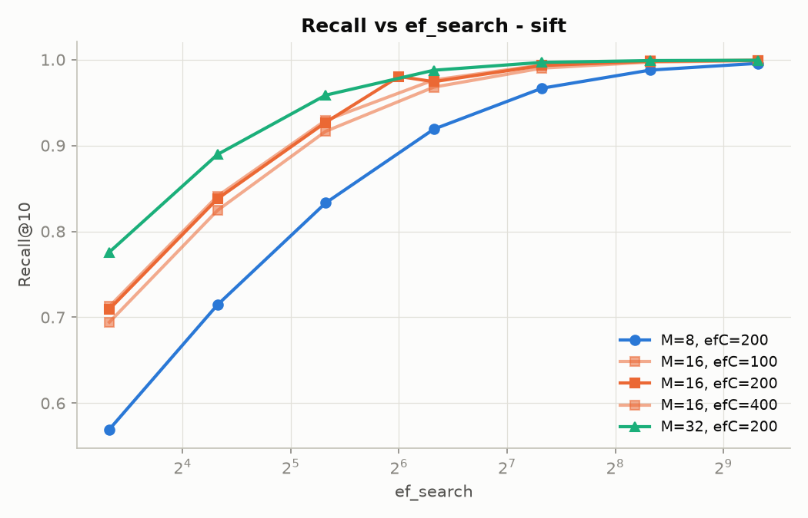
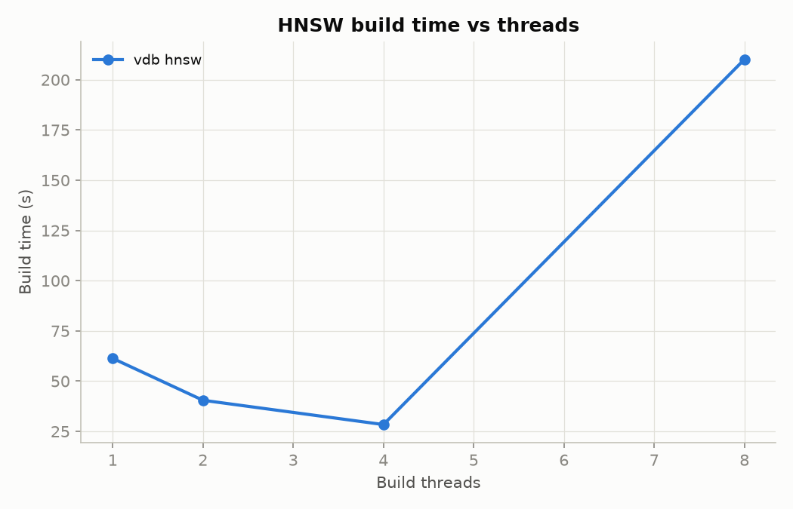

Build on 200k SIFT rows: 61 s / 40 s / 28 s / 26 s with 1 / 2 / 4 / 8 threads. The laptop has 4
physical cores, so hyper-threads add little. Renumbering the graph in BFS order puts neighbours next to
each other in memory and raises QPS by 23–40% at identical recall:

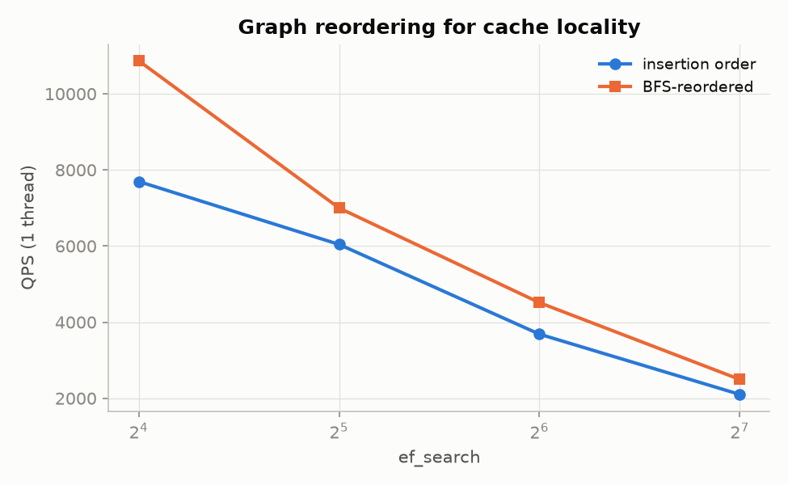

Where the time goes (`bench/run_profile.sh`: `perf` on 20 s of single-threaded SIFT1M searches; raw
output in `bench/results/perf_*.txt`):

| | cycles/query | instructions per cycle | cache misses/query | hottest code |
|---|---|---|---|---|
| HNSW, ef 80 | 640k | 0.40 | 29,065 | graph walk 49%, AVX-512 L2 39% |
| HNSW-SQ8, ef 80 | 538k | 0.57 | 14,107 | graph walk 42%, SQ8 distance 38% |
| IVF-PQ, nprobe 64 | 1.4M | 2.29 | 19,365 | code scan 72%, re-rank 19% |

Graph search is memory-bound: the core retires 0.4 instructions per cycle while it waits on random
vector and neighbour-list loads. SQ8 halves the misses, which is why it is faster. IVF-PQ is
compute-bound in its table-lookup loop.

### Filtered search

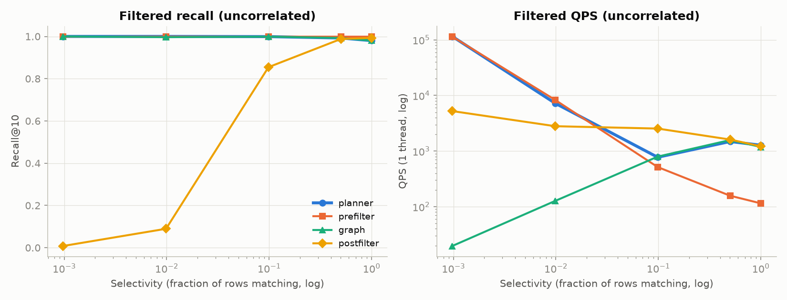
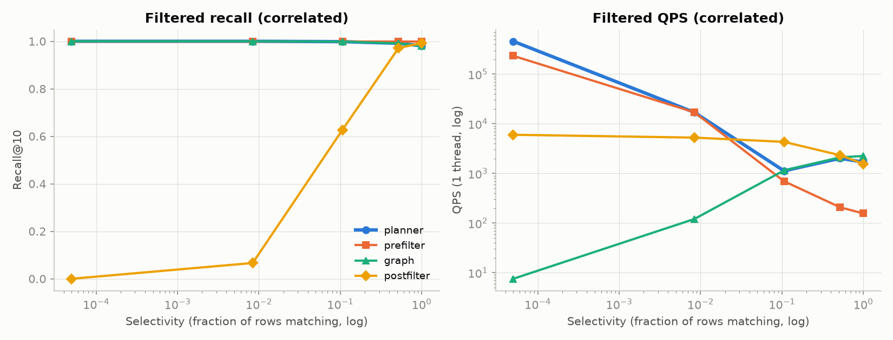

The planner picks per segment and tracks the best single strategy at every selectivity, keeping
recall@10 ≥ 0.98 from 0.1% to 100%: exact scan of the matches when they are few (115k QPS at 0.1%,
where a filtered graph walk manages 20 QPS), filtered graph search when they are many.

### Storage engine

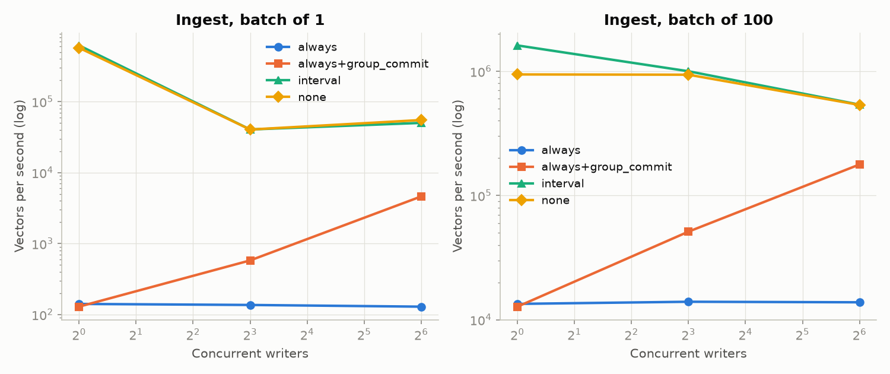

| Writers × batch, `sync: always` | without group commit | with group commit |
|---|---|---|
| 1 × 1 | 141 vectors/s | 129 vectors/s |
| 64 × 1 | 129 /s, p50 500 ms | **4,608 /s**, p50 14 ms |
| 64 × 100 | 13,807 /s | **177,547 /s** |

`sync: interval` and `none` reach 0.5–1.6 M vectors/s. Bulk loading 200k SIFT rows over HTTP takes 25 s.

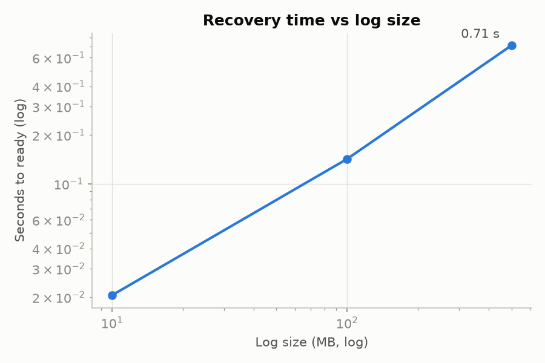

Replaying a 500 MB log (914k records) takes 0.71 s; opening a 200k-row segment takes 34 ms, or 49 ms
with CRC verification.

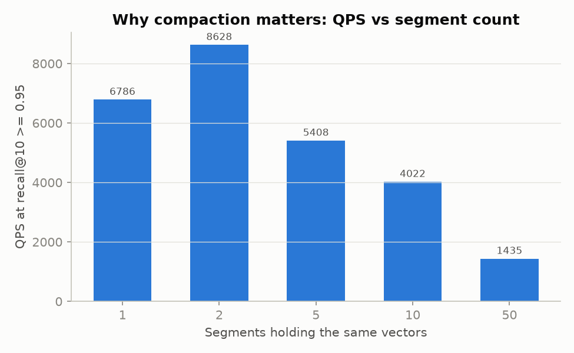
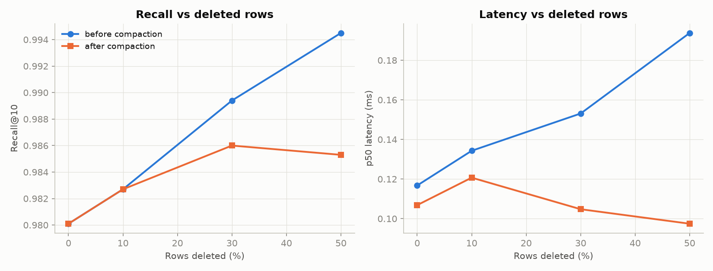
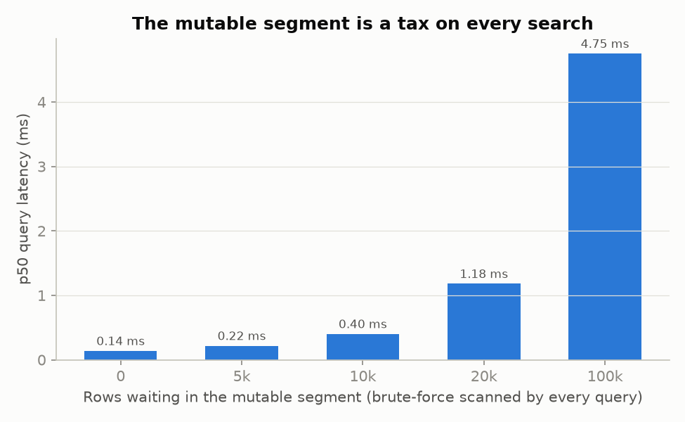

Each segment is its own graph, so throughput falls with the segment count (8.3k QPS on one segment, 1.4k
on 50, at similar recall). Bulk load, size-tiered compaction and merge-into-largest keep it low. Half the
rows deleted costs 40% of QPS until compaction, which then restores it (10.2k QPS). The exact-scanned
mutable segment takes a collection's p50 from 0.14 to 4.75 ms as it grows from empty to 100k rows,
which is why it flushes at 8 MB or 5 minutes (see the design decisions for the small-HNSW
alternative).

### Server

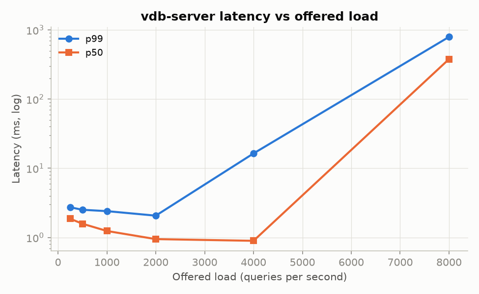

200k SIFT rows (two segments), ef = 64, k = 10, 128 server threads, open-loop load generator:

| Offered QPS | Achieved | p50 | p99 | Errors |
|---|---|---|---|---|
| 250 | 250 | 1.86 ms | 2.73 ms | 0 |
| 1,000 | 999 | 1.24 ms | 2.40 ms | 0 |
| 2,000 | 1,990 | 0.95 ms | 2.07 ms | 0 |
| 4,000 | 3,978 | 0.90 ms | 16.4 ms | 13 of 40,000 |
| 8,000 | 7,542 | 378 ms | 792 ms | 6 of 80,000 |

The engine sustains ~8k QPS on this data in-process; above ~4k QPS the HTTP layer (one thread per
connection, JSON) is the limit. With 100 clients searching during a 200k-row bulk load, all 20,000
searches succeeded (p50 5.7 ms, p99 36.8 ms).

From Python, a batched `col.search` on the same 200k-row collection matches the C++ runner within this
laptop's run-to-run noise: 6,014 vs 5,293 QPS at ef = 64, 10,204 vs 12,211 at ef = 32, single-threaded.
The binding adds no copy and releases the GIL, so 8 threads reach 15,844 QPS.

Kernel micro-benchmarks, one 128-d L2 distance: scalar 79 ns, AVX2 27 ns, AVX-512 10.5 ns.

### RAG: does recall loss hurt answers?

40,000 Simple English Wikipedia passages embedded with all-MiniLM-L6-v2 (384-d, cosine). 59 questions
in `rag/questions.jsonl` whose source article is in the corpus. A question is a hit when a passage from
that article is in the top 5. Recall@5 is measured against the exact top 5 for the same question.

| Search setting | exact | HNSW | HNSW-SQ8 | IVF-PQ |
|---|---|---|---|---|
| default (ef 64, nprobe 16): hit rate@5 / recall@5 | 0.797 / 1.000 | 0.797 / 0.997 | 0.797 / 0.997 | 0.797 / 0.942 |
| ef 20, nprobe 4 | 0.797 / 1.000 | 0.780 / 0.986 | 0.797 / 0.990 | 0.797 / 0.875 |
| ef 10, nprobe 2 | 0.797 / 1.000 | 0.780 / 0.973 | 0.797 / 0.969 | 0.729 / 0.793 |
| ef 5, nprobe 1 | 0.797 / 1.000 | 0.780 / 0.895 | 0.797 / 0.908 | 0.661 / 0.631 |
| ms per query (default) | 4.3 | 0.24 | 0.34 | 0.35 |

The embedding model, not the index, sets the ceiling: exact search misses the same 12 questions as the
others. At default settings approximate search costs nothing. Recall@5 can fall to ~0.9 before a single
answer is lost, because what matters is whether *any* passage from the right article is retrieved, and
those are rarely the borderline 5th neighbours. IVF-PQ at nprobe 1 (recall 0.63) does lose answers:
hit rate falls from 0.80 to 0.66.

`ask.py` end to end, for "Who discovered penicillin?": embedding the question takes 9 s on the first
call (it loads the model), opening the collection 65 ms, and the search 0.6 ms. The answer was streamed
from `rag/mock_llm_server.py`, an extractive stand-in that quotes the top passage. Point `LLM_URL` at
your own OpenAI-compatible server for real answers; no LLM was available on this laptop.

## Correctness and durability

A fast index that silently returns wrong neighbors, or a database that loses writes, is
worthless, so the tests carry as much weight as the benchmarks.

| Test | What it proves | How |
|---|---|---|
| `distance_test` | SIMD matches scalar | every real dimension 1–1024 (zero-padded), relative error < 1e-4, for every kernel set the CPU supports |
| `topk_test` | the heap keeps exactly the k smallest | vs `std::partial_sort` on random arrays with many ties; thread-pool nesting |
| `flat_test` | exact search matches ground truth | brute force for L2 / IP / cosine; the shipped Fashion-MNIST ground truth at recall@100 ≥ 0.999 |
| `hnsw_test` | the graph is well formed | no self-links, no duplicates, no node over its limit, every node reachable on layer 0; level histogram ≈ 1/M; parallel build; save/load identical |
| `pq_test`, `index_test` | quantization bounds hold | SQ8 error ≤ half a step; PQ table distance = distance to the decoded vector; all five index types round-trip through save/load |
| `wal_test` | records round-trip | torn tails cut at every byte; mid-file corruption reported; no writes after a failed fsync |
| `recovery_test` | a crash at any step recovers | `FaultInjectionEnv` crashes after every *k*-th mutating I/O call (k = 0, 1, 2, …) through flush, compaction, bulk load and plain writes, then drops all unsynced data (optionally tearing it in half) and checks every acknowledged write |
| `compaction_test` | deletes never come back | catch-up of deletes made *during* compaction; recall restored after compaction; bulk load → one segment; segments settle to ≤ 2 |
| `filter_test` | every strategy is correct | bitmap indexes vs row-by-row evaluation on 20k random rows; planner and exact path vs filtered brute force at 0.1–100% selectivity |
| `model_test` | the engine behaves like a map | 1,500 random upserts, deletes, filtered searches, flushes, compactions and reopens per seed vs `std::map` + brute force |
| `concurrency_test` | no races; no deleted ids in results | 8 readers, 2 writers, deletes, forced flushes and compactions; final contents vs a reference model, before and after reopen |
| `server_test`, `tests/api_test.py` | API contract and error codes | in-process and against a spawned `vdb-server` (pytest + httpx), including graceful SIGTERM shutdown |
| `tests/test_python.py` | the bindings | zero-copy input, filters, reopen, 8 Python threads searching concurrently |
| `tools/crash_test.py` | no acknowledged write is lost | kill -9 harness (below) |
| `tests/fuzz/*` | parsers never crash | libFuzzer on the WAL reader, manifest decoder, filter parser and binary upsert parser |

Results on this machine:

- **All 15 C++ test binaries pass** in release, under **AddressSanitizer + UBSan**, and
  the multi-threaded suites pass under **ThreadSanitizer** with zero reports (the stress
  test ran for 30 s under TSan).
- **kill -9 harness**: **1,000** random SIGKILLs (10 ms–2 s after the writers start;
  seed 537666013, 23 minutes), sync mode `always`, 4 writer threads upserting and
  deleting 800 ids: **zero lost acknowledged writes, zero half-applied writes, every
  restart clean**.
- **Fuzzing**: each parser ran 60 s (0.4–3.5 million inputs each) with no crash.
- The fault-injection crash tests walk a crash point through every I/O step of a flush
  (≈ 40 steps), a compaction and a bulk load.

Bugs these caught while building it (the "story" kind): ThreadSanitizer flagged a
use-after-free where `for (auto& s : snapshot()->on_disk)` let the temporary
`shared_ptr` die before the loop body ran (C++20 does not extend that lifetime), so a
concurrent flush could free the vector being iterated. The fault-injection tests caught
`CURRENT` disappearing after a simulated power loss, which turned out to be the test
environment's own rename-undo logic (fixed). A first latency measurement of the server
showed every request costing ~44 ms: Nagle's algorithm plus delayed ACKs, fixed with
`TCP_NODELAY`. And the first HNSW recall numbers looked ~0.3 low; comparing against
hnswlib on the same data showed the test generator drew queries from different clusters
than the base vectors, not an index bug.

## Limitations

- Single node: no replication or sharding.
- Data size is bounded by RAM: segments are memory-mapped, and HNSW graph search touches
  random pages, so a collection much larger than memory pages heavily.
- A batch upsert is not atomic: each point is its own log record, so a crash can keep a
  prefix of a batch. A single upsert is atomic; bulk load is all-or-nothing.
- Bulk load accepts only ids not already in the collection; upserts of existing ids go
  through the normal write path.
- Deleted rows stay in their segment (and its graph) until compaction rewrites it;
  recall and latency degrade as deletes pile up (see the delete-decay chart).
- Integer metadata compares as doubles: exact up to 2^53.
- Recovery replays the whole log tail into memory; a very large unflushed log means a
  slow restart (see the recovery chart). Flushing every ~8 MB keeps it short.
- No authentication or TLS; put it behind a proxy.
- cpp-httplib holds one worker thread per open keep-alive connection, so `--threads`
  must exceed the number of concurrent clients (default 64). With 16 threads and 64
  client connections, measured throughput was stuck at 40% of the offered load.
- The RAG demo was run on a CPU: MiniLM embeds ~23 passages/s here, so the corpus is
  40k passages rather than the plan's 100k–500k (use a GPU for the full size).
- Benchmarks were run in WSL2 on a laptop, which adds virtualization noise and makes
  `fsync` numbers specific to that virtual disk.
- Storage assumes POSIX rename semantics. Windows-backed folders under WSL (`/mnt/c`), especially
  ones synced by OneDrive, can refuse renames; keep data directories on a Linux file system.

## Repository layout

```
include/vdb/        public API: types, status, options, metadata, collection
src/util/           aligned buffers, CRC32C, thread pool, top-k heap, delete bits, metrics, datasets
src/distance/       scalar, AVX2, AVX-512 and NEON kernels; runtime dispatch
src/index/          Index interface, flat, hnsw/ (graph, visited pool), quant/ (k-means, SQ8, PQ, IVF-PQ)
src/storage/        Env (POSIX + fault injection), WAL, segment files, manifest
src/meta/           schema, metadata encoding, filter parser, column indexes
src/engine/         mutable segment, id map, planner, compaction policy, CollectionImpl
src/server/         HTTP API, metrics, binary format, collection manager, main
python/             nanobind module, vdb package, HTTP client
tools/              vdb_bench, convert_hdf5.py, crash_test.py
bench/              micro_bench, baselines.py, server_load.py, plot.py, run_all.sh, run_profile.sh, results/
tests/              unit, storage, recovery, concurrency, model, filter, server and HTTP API tests; fuzz/
rag/                ingest.py, ask.py, eval.py, mock_llm_server.py
demo/               record.py and render.py (the demo video), vdbctl.py, run_demo.sh
docs/               API.md, WRITEUP.md, demo/ (the video and GIF)
```

## References

- Malkov and Yashunin, *Efficient and robust approximate nearest neighbor search using
  Hierarchical Navigable Small World graphs* (Algorithms 1–5), and the hnswlib source.
- Jégou, Douze and Schmid, *Product Quantization for Nearest Neighbor Search*, IEEE
  TPAMI 2011; Douze et al., *The Faiss Library*, 2024.
- LevelDB log format; RocksDB WAL and MANIFEST documentation.
- Dan Luu, *Files are hard*.
- Lemire et al., *Better bitmap performance with Roaring bitmaps*.
- Patel et al., *ACORN* (SIGMOD 2024); Gollapudi et al., *Filtered-DiskANN* (WWW 2023).
- Aumüller, Bernhardsson and Faithfull, *ANN-Benchmarks*.
- Subramanya et al., *DiskANN* (NeurIPS 2019).
